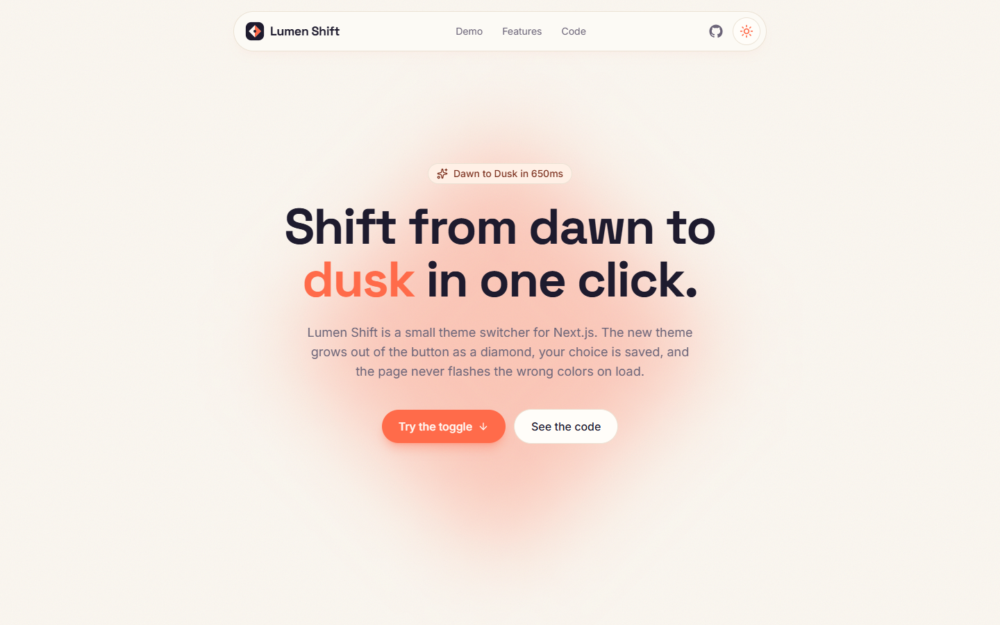
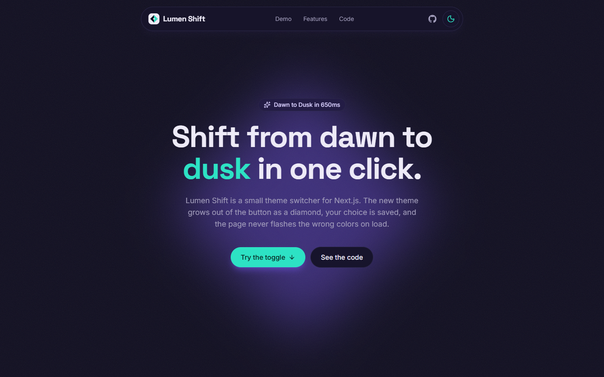
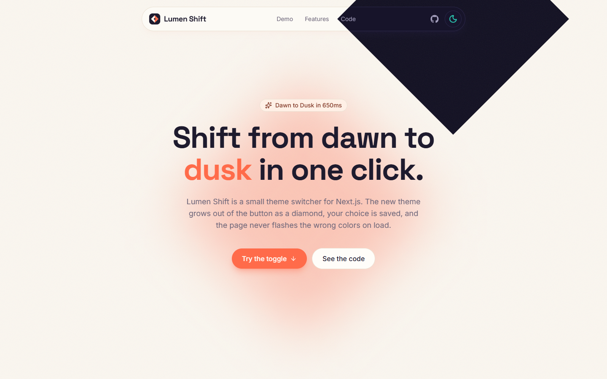
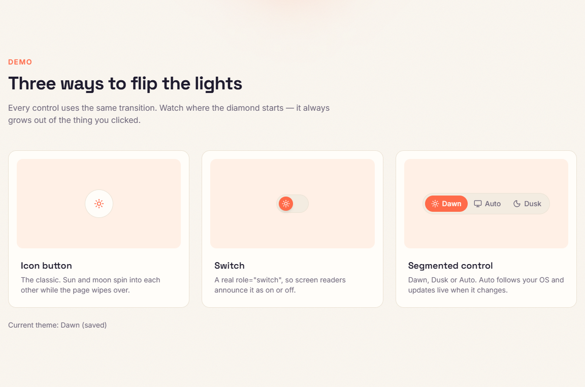
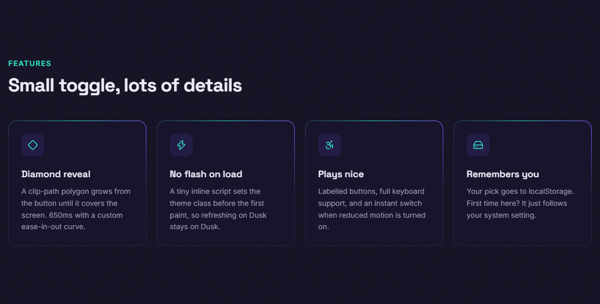
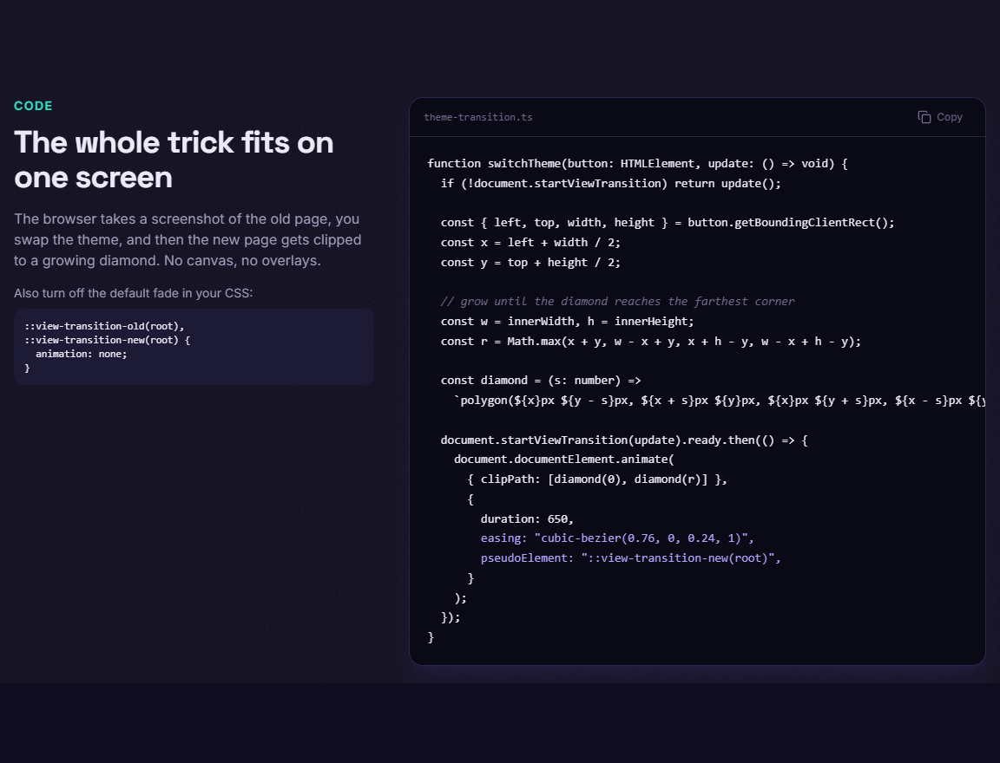
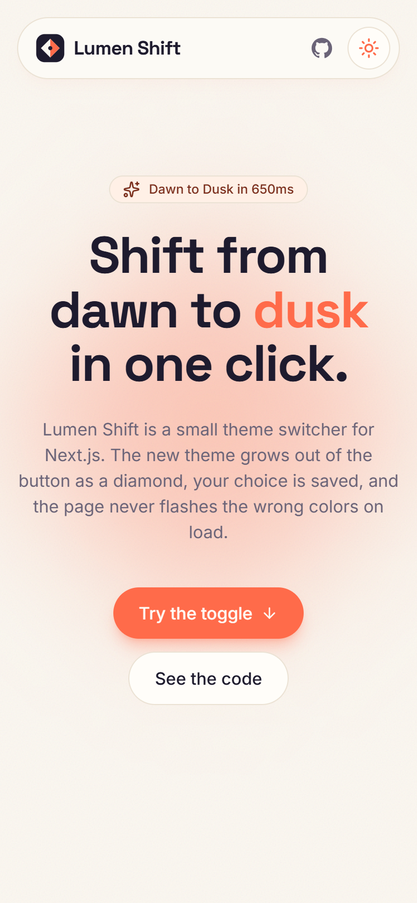
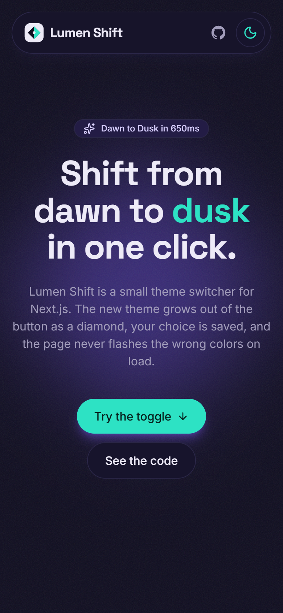

# Lumen Shift

A landing page for a theme switcher I built with Next.js. When you change the theme, the new one grows out of the button as a diamond instead of the usual circle.

There are two themes:

- **Dawn** (light) - warm cream background with coral
- **Dusk** (dark) - deep indigo with teal and violet





## The transition

This is a frame from the middle of a switch. The dark theme is growing out of the toggle in the navbar:



It works with the [View Transitions API](https://developer.mozilla.org/en-US/docs/Web/API/View_Transition_API). The browser takes a snapshot of the old page, the theme gets changed, and then the new page is animated with a `clip-path: polygon(...)` that starts at the center of the button and grows until it covers every corner of the screen (650ms, `cubic-bezier(0.76, 0, 0.24, 1)`).

If the browser doesn't support `document.startViewTransition` or you have reduced motion turned on, the theme just switches instantly.

The code for this is in `lib/theme-transition.ts`.

## Features

- 3 toggle styles: icon button, switch and segmented control (Dawn / Auto / Dusk)
- Sun/moon icon morph with `motion`
- Your choice is saved in localStorage
- First visit uses your system preference, and "Auto" keeps following it
- No flash of the wrong theme on refresh (small inline script in `app/layout.tsx`)
- Keyboard accessible (the segmented control works with arrow keys)
- Feature cards with a rotating gradient border
- Code block with a copy button
- Works on mobile

| Demo | Features |
| --- | --- |
|  |  |



### Mobile

<p>
  
  
</p>

## Tech stack

- Next.js 15 (App Router) + TypeScript
- Tailwind CSS v4
- motion
- lucide-react
- Space Grotesk and Inter from `next/font`

All the colors are CSS variables in `app/globals.css`, so if you want to change a theme you only need to edit that file.

## Running it locally

```bash
git clone https://github.com/sirine2907/lumen-shift.git
cd lumen-shift
npm install
npm run dev
```

Then open http://localhost:3000.

Other scripts:

```bash
npm run build   # production build
npm run lint    # eslint
```

## Project structure

```
app/
  globals.css        theme colors, grain texture, view transition css
  layout.tsx         fonts + the no-flash script
  page.tsx
components/
  theme-provider.tsx theme state, localStorage, system preference
  theme-toggle.tsx   icon button
  theme-switch.tsx   switch
  theme-segmented.tsx
  navbar.tsx, hero.tsx, demo.tsx, features.tsx, code-snippet.tsx, footer.tsx
lib/
  theme-transition.ts  the diamond animation
  utils.ts             cn() helper
```

## Browser support

The diamond animation works in browsers that support View Transitions (Chrome, Edge, Safari 18+, recent Firefox). Everywhere else the theme still changes, just without the animation.
